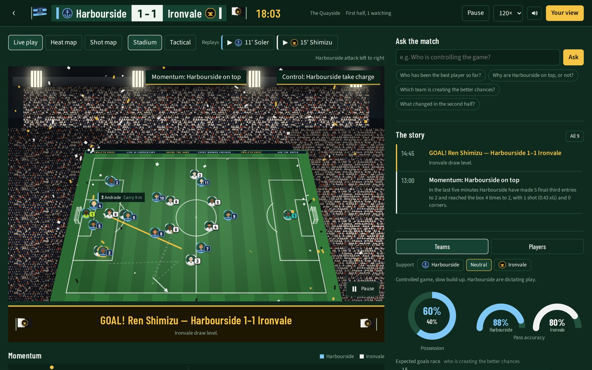
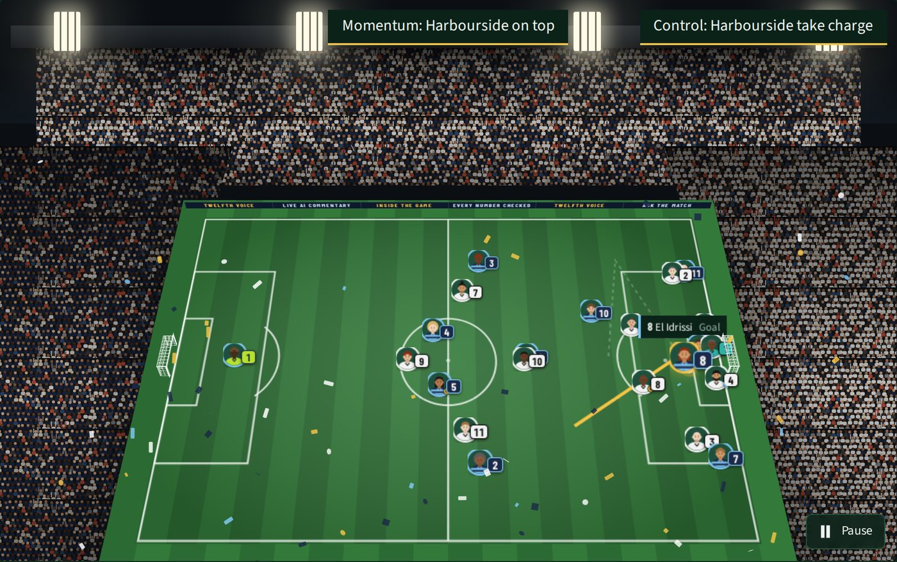
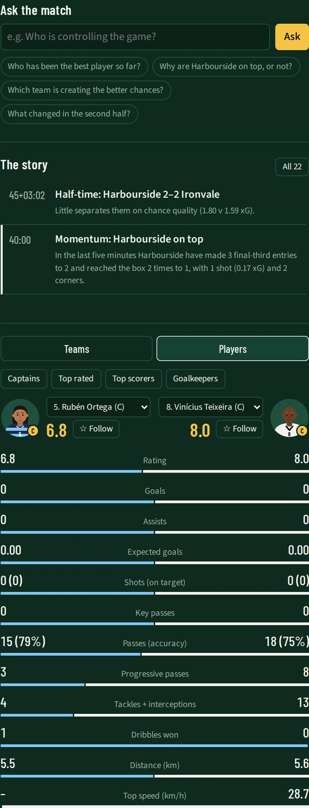
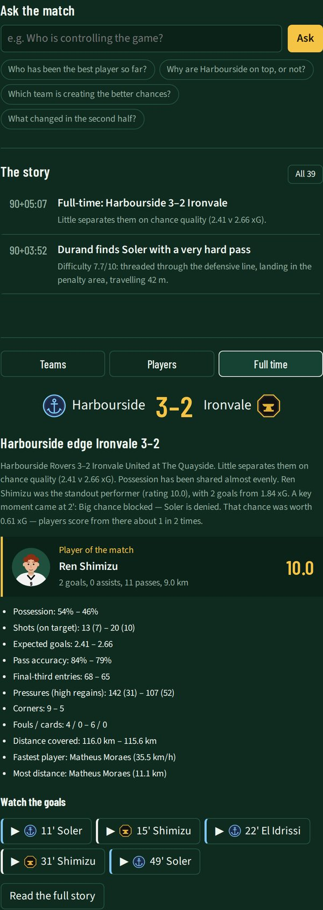

# Twelfth Voice

[](https://github.com/visualizefuture/twelfth-voice/actions/workflows/ci.yml)
[](https://github.com/visualizefuture/twelfth-voice/actions/workflows/deploy.yml)

**Every fan gets their own match.**

Twelfth Voice turns synthetic football events into explainable, personalised match intelligence. A live broadcast for one viewer: a floodlit stadium, all 22 players, broadcast graphics, and commentary written by an AI crew that **fact-checks every number before it goes on air**, in the viewer's language and at their level of detail.

**▶ Try it live: [twelfth-voice.lemonpond-53891994.eastus2.azurecontainerapps.io](https://twelfth-voice.lemonpond-53891994.eastus2.azurecontainerapps.io)** (the first visit can take a few seconds while the free database wakes up)

**🎬 Watch the 2-minute demo: [youtu.be/0zcZGuSOt4o](https://youtu.be/0zcZGuSOt4o)**

Built for the *Microsoft × Premier League: Inside the Game* developer hackathon.



> All clubs, players, stadiums and matches are fictional and synthetically generated. No real match data, names, logos or footage are used.

## What it does

- **A live match for every viewer.** A calibrated simulator plays the match event by event: passes, shots, xG, pressing, sprints. A stadium view shows all 22 players in their kits, the ball bending and rising through each kick, and broadcast graphics placed by each insight's overlay hint.
- **An AI broadcast crew that checks its facts.** Commentator, Fact-checker, Localizer, Analyst and Storyteller agents built with Microsoft Agent Framework on Microsoft Foundry. Every number in a draft is traced back to the match data; anything that fails goes back for one rewrite, or the data-written line stays. The crew room shows every draft, verdict and reason.
- **Your view.** Fan or analyst, your club, follow one player, nine languages. The same match tells a different story to each viewer, over their own SignalR stream.
- **Ask the match.** Ask anything in any language; the Analyst agent answers by calling tools over the live data.
- **Goals you can hear and replay.** A neural goal call from Azure AI Speech in the viewer's language, a crowd roar and confetti, then a slow-motion replay rebuilt from the event log.
- **Teams, players and full time.** Head-to-head team stats, any two players compared live, and a full-time summary with the player of the match and every goal ready to replay.
- **An MCP server.** The live match data as tools for any MCP client, such as GitHub Copilot agent mode.

| Goal: call, confetti and crests | Players compared | Full time |
|---|---|---|
|  |  |  |

## Built with Microsoft

| Technology | How Twelfth Voice uses it |
|---|---|
| **Microsoft Foundry** (`gpt-4.1-mini`) | The model behind every agent, reached keylessly with a managed identity |
| **Microsoft Agent Framework** | The broadcast crew: Commentator, Fact-checker, Localizer, Analyst (with tools) and Storyteller |
| **Model Context Protocol** (C# SDK) | `/mcp` exposes the live match data as tools for any agent |
| **Azure AI Speech** | Neural goal calls and spoken commentary in nine languages, cached per clip |
| **Azure Container Apps** | One container serves the API, the SignalR hub, the MCP server and the Angular app |
| **Azure SQL Database** | Matches, events and insights (free offer, Entra-only sign-in, managed identity) |
| **GitHub Actions** | CI on every pull request (build, tests, vulnerability checks, container smoke test) and deploys on every merge, signed in with OIDC |
| **.NET 10, ASP.NET Core, SignalR, EF Core** | The simulator, intelligence engine, API and live streams |

## Architecture


**Facts from code, words from AI, nothing unverified on air.** The simulator and intelligence engine produce every number and a rule-written line for each moment, shown instantly. The crew rewrites it per audience and language; the line is swapped in only if the fact-checker approves it. If the model is slow, over budget or wrong, the data-written line stays. Deployment details are in [docs/DEPLOY.md](docs/DEPLOY.md).

## The pipeline

| Stage | What it does | Where |
|---|---|---|
| **Ingest** | A deterministic simulator generates football-realistic matches and streams events live (passes, carries, dribbles, shots, tackles, pressure, possession changes, cards, subs, sprints, tracking). | `TwelfthVoice.Simulator` |
| **Interpret** | Running team and player stats, pass distance / accuracy / difficulty, ball and shot speed, xG, distance and top speed, plus rolling momentum, control-vs-chaos, pressing and tempo indicators. | `TwelfthVoice.Intelligence` |
| **Explain** | Every insight carries a plain-language *why it matters*, an analyst note and the evidence numbers it was derived from. | `MatchAnalyzer`, `Narration`, `RecapBuilder` |
| **Render** | Insights include a machine-readable overlay hint (template, placement, duration, priority), streamed live over SignalR and drawn over a live pitch. | `OverlayHint`, `TwelfthVoice.Api`, `web/` |
| **Personalise** | Fan vs analyst modes, favourite club, player-focus mode and nine languages: each viewer gets their own stream, translated and re-checked by the crew. | `InsightPersonalizer`, SignalR hub, `BroadcastCrew` |

## Quick start

Requires the [.NET 10 SDK](https://dotnet.microsoft.com/download).

```bash
dotnet build
dotnet test

# List the fictional clubs and squads
dotnet run --project src/TwelfthVoice.Cli -- teams

# Watch a match live (one match minute per second), casual mode
dotnet run --project src/TwelfthVoice.Cli -- replay --home HAR --away IRV --seed 7

# Analyst mode, following the Harbourside number 9 at 2x speed
dotnet run --project src/TwelfthVoice.Cli -- replay --home HAR --away IRV --seed 7 --speed 120 --mode analyst --follow HAR-09

# Automated recap
dotnet run --project src/TwelfthVoice.Cli -- recap --home KIN --away WMC --seed 11

# Export a full dataset (match, events, insights, final stats, recap) as JSON
dotnet run --project src/TwelfthVoice.Cli -- generate --home KIN --away WMC --seed 11 --out data/kin-wmc-11.json --pretty
```

The same seed and teams always produce the same match, event for event, which makes demos and tests repeatable.

## Run everything from Visual Studio

Open `TwelfthVoice.sln`, pick **API + fan app** from the startup drop-down next to the Start button, and press **F5**. The API starts on port 5080 and the Angular app on port 4200, with a browser opening on the app. The first build runs `npm install` for the app, so it takes a minute.

## The AI broadcast crew

Twelfth Voice uses **Microsoft Agent Framework** agents on a **Microsoft Foundry** model deployment. Each has one job:

| Agent | Job |
|---|---|
| **Director** (policy) | Decides which moments deserve AI commentary and which only need translating, within a spending cap. |
| **Commentator** | Rewrites a moment for each audience: fan or analyst, neutral or supporting one club. |
| **Fact-checker** | Traces every number in the draft back to the match data, then an AI reviewer checks the claims. A rejected draft goes back to the Commentator once, with the reasons. |
| **Localizer** | Translates into the viewer's language; the numbers are checked again. |
| **Analyst** | Answers "Ask the match" questions by calling tools over the live data. |
| **Storyteller** | Writes the match story from the verified recap. |

**Facts from code, words from AI, nothing unverified on air.** Viewers get the rule-written line instantly; the crew's version replaces it seconds later only if it passes the fact-check. If the model is slow, over budget or wrong, the data-written line simply stays.

### Connect it to Microsoft Foundry

1. In Microsoft Foundry, deploy a chat model (we use `gpt-4.1-mini`, Global Standard).
2. Store the endpoint and key as user secrets (they never go into the repo):

```bash
dotnet user-secrets set "AzureAI:Endpoint" "https://<your-resource>.services.ai.azure.com/openai/v1/" --project src/TwelfthVoice.Api
dotnet user-secrets set "AzureAI:ApiKey" "<your-key>" --project src/TwelfthVoice.Api
```

Leave out the key to sign in with Microsoft Entra ID instead (`az login` locally, managed identity in Azure; your account needs the *Cognitive Services OpenAI User* role). `AzureAI:Deployment` changes the model, and `AzureAI:MaxCallsPerHour` caps spending. `GET /api/status` shows the crew's calls, approvals, rejections and fallbacks.

## Sound: the goal call and spoken commentary

On a goal the browser makes a crowd roar (Web Audio, no audio files) and plays a goal call from an **Azure AI Speech** neural voice in the viewer's language: the goal word stretched out and climbing, then the scorer and the score. Switch on **Read the commentary aloud** in *Your view* to hear the crew's fact-checked lines too. The mute button sits in the score bug.

```bash
dotnet user-secrets set "Speech:Key" "<your-speech-key>" --project src/TwelfthVoice.Api
dotnet user-secrets set "Speech:Region" "eastus2" --project src/TwelfthVoice.Api
```

The key stays on the server. The browser can only ask for moments the match produced (by insight id), never arbitrary text, and each clip is cached, so a goal is synthesised once however many fans hear it. The free F0 tier (500,000 characters a month) covers development. Without a key the app falls back to the browser's own voice. `GET /api/status` shows clips and characters used.

| Method | Route | What it does |
|---|---|---|
| GET | `/api/matches/{id}/speech/{insightId}/call?language=` | The goal call as MP3 |
| GET | `/api/matches/{id}/speech/{insightId}?mode=&language=&favoriteTeamId=&focusPlayerId=` | A moment read aloud, exactly as that viewer sees it |

## MCP server

The API is also a **Model Context Protocol** server at `http://localhost:5080/mcp`, so any MCP client (GitHub Copilot agent mode, Claude, your own agents) can use the live match data as tools:

| Tool | What it does |
|---|---|
| `list_teams`, `list_matches` | The clubs, and the matches running now |
| `start_match` | Simulate and start a match `{ home, away, seed, speed }` |
| `get_match_state` | Score, clock, momentum, control vs chaos, tempo |
| `get_team_stats`, `get_player_stats`, `get_top_players` | Team, player and leaderboard statistics |
| `get_key_moments`, `get_momentum` | Key moments with why they mattered; momentum over time |
| `get_recap`, `get_crew_room` | The recap, and the AI crew's drafts and fact-checks |

The repo's `.mcp.json` registers it for Visual Studio. In VS Code, add the same entry to `.vscode/mcp.json`. Then, with the API running, ask Copilot in agent mode something like *"Start Harbourside v Ironvale and tell me who's controlling the game."* Set `Mcp:Enabled` to `false` to turn the endpoint off.

## Fan app (Angular)

Requires [Node.js 22](https://nodejs.org/) or later. Run the API first, then in a second terminal:

```bash
cd web
npm install
npm start
```

Open **http://localhost:4200**. The dev server forwards `/api` and `/hubs` to the API on port 5080.

- **Stadium and tactical cameras**: the pitch in 3D with stands, floodlights and goals, or a flat tactical board; all 22 players with shirt numbers; curved, lofted ball flight.
- **Broadcast graphics** in a rail under the pitch, so they never cover the play; short chips on the pitch's top edge.
- **Heat map** for either club or the player you follow, and a **shot map** sized by xG.
- **Momentum chart**: who was on top, minute by minute, with goals marked.
- **Goals**: neural goal call, crowd roar, confetti in the club's colours, and an automatic slow-motion replay; every goal has a replay button with the scorer's crest.
- **Side tabs**: Teams (head-to-head stats), Players (any two players, live) and Full time (summary, player of the match, replays).
- **Your view**: fan or analyst, your club, follow a player, language, sound and replay settings.
- **Ask the match** and **The story** (the Storyteller's recap) beside the pitch and below it.

## Live API

```bash
dotnet run --project src/TwelfthVoice.Api
```

Then open **http://localhost:5080** for the live console: pick two clubs, kick off, and switch between casual and analyst modes, a favourite club or a single player while the match plays.

**Storage.** By default the API uses SQL Server LocalDB (installed with Visual Studio) and creates the `TwelfthVoice` database on first run. If no database is reachable it logs a warning and keeps running in memory; `GET /api/status` shows which mode is active. To skip SQL entirely, use the *http (memory only)* launch profile or set `Storage__Provider=None`. For Azure SQL, set `ConnectionStrings__TwelfthVoice`.

**REST** (OpenAPI document at `/openapi/v1.json`):

| Method | Route | Purpose |
|---|---|---|
| GET | `/api/teams` | Fictional clubs and squads |
| POST | `/api/matches` | Simulate a match and start it live `{ homeTeamId, awayTeamId, seed, speed, autoStart }` |
| GET | `/api/matches` | Live matches plus recent stored matches |
| POST | `/api/matches/{id}/start` · `/pause` · `/resume` | Control playback |
| PUT | `/api/matches/{id}/speed` | `{ speed }` match seconds per real second |
| GET | `/api/matches/{id}/state` | Scoreboard, momentum, control, tempo (`?focusPlayerId=`) |
| GET | `/api/matches/{id}/snapshot` | Full team and player statistics |
| GET | `/api/matches/{id}/insights` | Personalised insights (`?mode=analyst&favoriteTeamId=HAR&focusPlayerId=HAR-09&language=es`) |
| GET | `/api/matches/{id}/events` | Released events (`?after=sequence&type=Shot`) |
| GET | `/api/matches/{id}/timeline` | Momentum, control, xG and score every ~30 match seconds |
| GET | `/api/matches/{id}/recap` | Automated recap (facts) |
| GET | `/api/matches/{id}/story` | The Storyteller's recap (`?mode=analyst&language=es`) |
| POST | `/api/matches/{id}/ask` | Ask the Analyst agent `{ question, mode, language }` |
| POST / PUT / GET | `/api/profiles` | Save and load viewer profiles |
| GET | `/api/status`, `/health` | Service and storage status |

**SignalR** hub at `/hubs/match`:

- Call `JoinMatch(matchId, profile)` → returns summary, match info, current state and recent insights so the screen can render at once.
- Receive `insight` (personalised for that viewer), `state` (scoreboard strip, every ~30 match seconds and on key moments) and `status` (live / paused / finished / speed).
- Call `UpdateProfile(profile)` to change mode, club, player or language mid-match, and `SubscribeEvents(true)` for the raw event feed (`event`), e.g. for an overlay renderer.

A viewer profile is `{ mode: "Casual" | "Analyst", favoriteTeamId, focusPlayerId, language }`.

## Explainable by design

The numbers on screen come from small, readable models in [`FootballMath`](src/TwelfthVoice.Domain/FootballMath.cs), and the simulator uses the *same* models to decide outcomes:

- **xG**: logistic model on shot distance and goal-mouth angle (headers and big chances adjusted).
- **Pass difficulty (0–10)**: length, forward progression, pressure, through balls, crosses, passes into the box.
- **Control vs chaos (0–100)**: pass completion, how often the ball changes hands, and how often fouls and duels break the game up, over the last five minutes.
- **Momentum (−100…100)**: weighted final-third entries, box entries, shots (by xG), corners and high regains for each side over the last five minutes.

The simulator is calibrated to roughly 1,000 passes at ~83% accuracy, ~25 shots, ~3 xG and ~2.7 goals per match.

## Repository layout

```
src/
  TwelfthVoice.Domain        Event model, pitch geometry, clock, football maths, JSON settings
  TwelfthVoice.Simulator     Fictional league, squad generator, match simulator, live feed
  TwelfthVoice.Intelligence  Stats, rolling indicators, insights, recap builder
  TwelfthVoice.Cli           Command-line runner (teams / generate / recap / replay)
  TwelfthVoice.Agents        The AI broadcast crew: Agent Framework agents, fact-checker, analyst tools
  TwelfthVoice.Api           ASP.NET Core API, SignalR hub, EF Core storage, live console page
web/                         Angular fan app: stadium and tactical pitch, overlays, replays, tabs, personalised feed
deploy/azure-setup.sh        One-time Azure setup (Container Apps, Azure SQL, managed identities, GitHub OIDC)
tools/screenshots/           Playwright script that drives the whole app on CI and captures screenshots
Dockerfile                   One image: the Angular app served by the .NET 10 API
tests/
  TwelfthVoice.Tests         xUnit tests for simulator realism, stats, insights, personalisation and live sessions
docs/
  ARCHITECTURE.md            Architecture notes
  DEPLOY.md                  Deploying to Azure: setup, costs, configuration
  images/                    Screenshots and the architecture diagram
  EVENT-SCHEMA.md            Event and insight formats for overlay renderers
```

## Roadmap

- [x] Synthetic match generator and live feed
- [x] Stats, trends and rule-based explanations
- [x] ASP.NET Core API + SignalR live channel, SQL persistence (LocalDB / Azure SQL)
- [x] Personalisation: casual vs analyst, favourite club, player focus, language preference
- [x] Multi-agent broadcast crew (Microsoft Agent Framework + Microsoft Foundry) with a fact-checker
- [x] Ask the match, and the Storyteller's recap
- [x] MCP server exposing live match data as tools
- [x] Goal call and spoken commentary with Azure AI Speech, crowd sound, waving club banners
- [x] Angular fan app: live pitch with overlays, heat and shot maps, momentum chart, personalised feed
- [x] Continuous integration: build and test on every pull request
- [x] Deployment to Azure Container Apps (see [docs/DEPLOY.md](docs/DEPLOY.md))

## License

MIT — see [LICENSE](LICENSE).
