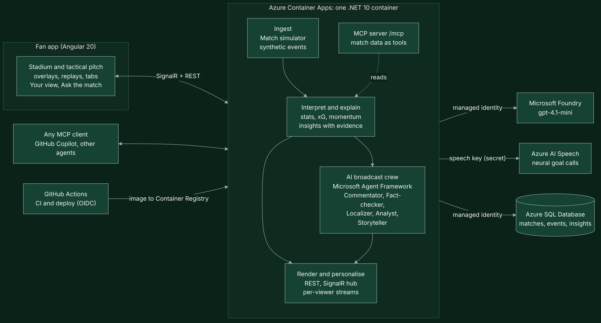

# Twelfth Voice: architecture

One .NET 10 container on Azure Container Apps runs the five stages of the pipeline and serves the Angular fan app.
The diagram source is [images/architecture.mmd](images/architecture.mmd) (Mermaid).

## How a moment reaches a viewer

1. **Ingest.** `MatchSimulator` produces a calibrated stream of events (passes, carries, shots, tackles, pressure, sprints,
   cards, subs). `MatchSession` releases them on the match clock at the chosen speed.
2. **Interpret.** `MatchAnalyzer` updates team and player stats and the rolling indicators (momentum, control vs chaos,
   pressing, tempo) with every event.
3. **Explain.** When something matters it emits an `Insight`: a headline, *why it matters*, an analyst note, the evidence
   numbers and the event sequences it came from, and an overlay hint (template, placement, duration, priority).
4. **Personalise.** `InsightPersonalizer` scores and words each insight for each viewer's profile (fan or analyst,
   favourite club, followed player). The rule-written line goes out at once over SignalR.
5. **Rewrite and check.** In the background, `BroadcastCrew` (Microsoft Agent Framework on Microsoft Foundry) asks the
   Commentator for a line per audience and the Localizer for the viewer's language. `NumberGuard` traces every number
   back to the evidence, then the Fact-checker agent reviews the claims. A rejected draft goes back once with the reasons;
   an approved one replaces the rule line on screen (`insightUpdate`). Everything is logged for the crew room.
6. **Render.** The fan app draws the pitch, the 22 players (synthetic tracking from the event positions and formations),
   the ball's flight and the broadcast graphics; goals get an Azure AI Speech call and a replay rebuilt from the event log.

## Agents

| Agent | Job | Model calls |
|---|---|---|
| Director (policy) | Chooses which moments get AI commentary or only translation, within an hourly budget | none |
| Commentator | Rewrites a moment for one audience | 1, plus 1 retry when rejected |
| Fact-checker | Reviews the draft's claims after the deterministic number check | 1 for important moments |
| Localizer | Translates into the viewer's language; numbers checked again | 1 per language |
| Analyst | Answers *Ask the match* with tools over the live data | 1+ (tool calls) |
| Storyteller | Writes the full-time story from the verified recap | 1 |

## Design principles

1. **Facts from code, words from AI.** Every number comes from the deterministic intelligence layer; agents word,
   prioritise and translate, but never invent statistics, and nothing unverified goes on air.
2. **Works without AI.** Rule-based narration means the app runs, and stays correct, if the model is slow, over budget or
   switched off.
3. **Machine-readable first.** Insights are JSON with overlay hints, so any renderer can draw them in sync with the clock.
4. **Repeatable.** The same clubs and seed always produce the same match, event for event.
5. **No secrets in code.** Managed identities for Foundry and Azure SQL, OIDC for GitHub deploys; only the Speech key is
   held, as a Container Apps secret.
